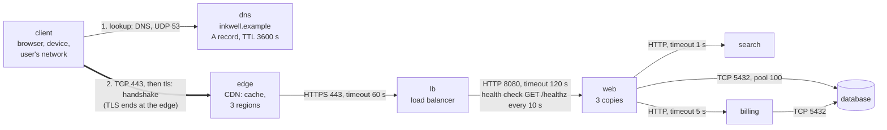

# Follow the packet: design note

The week 6 scenarios for issue #27. #28 writes the request-path diagram rubric from the Keep section
below, and #29 builds the lesson and the scenarios as data on the network path explorer from #3.

Week 6 teaches networking as a request sees it: DNS, TCP, TLS, HTTP, load balancing and timeouts.
The learner gets what an on-call person gets (a page, support tickets, dashboards, logs and the
output of `dig`, `curl -v` and `openssl s_client`) and places the failure on Inkwell's request path.
Phase 2's culture thread is **curiosity over procedure**, so no scenario can be solved by a fixed
checklist: the same browser error points at different hops in different scenarios, and each one has
a red herring that a checklist would follow.

## Where it sits

One new Practitioner lesson in week 6, `follow-the-packet` (a new permanent ID), on the lesson page,
like `inkwell-nines`. It plays ten scenarios in order and ends with the Keep, the learner's own
request-path diagram. Ten scenarios at three to five minutes each is 30 to 50 minutes, so progress
is saved per scenario and the learner can stop between any two (open question 2).

The learner has finished Phase 1, so they know Inkwell, its four services and its people, golden
signals (`ch6-seeing-inside`) and "what changed?" (`09-the-page`). Week 5 has taught them to read logs.
Week 6 is the first time they meet DNS, TLS and a load balancer by name. The lesson text (#29)
carries the tool walkthroughs; the video carries the idea and one story.

## The path

Inkwell's request path, used in every scenario and on the Keep. **Inkwell is made up**: the hops are
the common shape of a small web product, and every number on them is an assumption, labeled as one
in the data (see "Engine requirements").



The learner places a failure on one of **nine hops**. Eight are boxes; `tls` is drawn on the link
from the browser to the edge, because the handshake happens there and the certificate lives at the
edge. Keeping it separate from `edge` lets the path say _where TLS ends_ and lets a certificate fault
have its own answer.

| Hop        | What it does, in plain words                                                | Shared by                          |
| ---------- | --------------------------------------------------------------------------- | ---------------------------------- |
| `client`   | The user's browser, device, clock, trusted certificates and local network   | One user, or one network or device |
| `dns`      | Turns `inkwell.example` into an address; resolvers cache the answer for TTL | Everyone, cached per resolver      |
| `tls`      | The handshake: the edge shows a certificate, the browser checks it          | Everyone                           |
| `edge`     | The CDN: accepts connections in three regions, caches pages, forwards rest  | Everyone in a region               |
| `lb`       | Spreads requests over `web`'s copies; stops sending to copies that fail     | Every request that isn't cached    |
| `web`      | The website and editor                                                      | Every request that isn't cached    |
| `search`   | Finds documents; keeps its own index                                        | Search only                        |
| `billing`  | Checkout and subscriptions                                                  | Checkout only                      |
| `database` | Accounts, documents, orders                                                 | Editor, save, export, checkout     |

**Routes.** Which hops each kind of request passes, in order. This is what makes "which users are
hit" evidence.

| Request    | Route                                                         |
| ---------- | ------------------------------------------------------------- |
| `page`     | client, dns, tls, edge (cached; on a miss: lb, web)           |
| `editor`   | client, dns, tls, edge, lb, web, database                     |
| `save`     | client, dns, tls, edge, lb, web, database                     |
| `export`   | client, dns, tls, edge, lb, web, database (20–40 s by design) |
| `checkout` | client, dns, tls, edge, lb, web, billing, database            |
| `search`   | client, dns, tls, edge, lb, web, search                       |

**Users.** A small fixed population of weighted segments, so "who is hit" is a set of rows, not a
free-form story: three regions (`na`, `eu`, `ap`), three resolvers (two ISPs and a public one), two
device ages (`current`, and `old` at about 3%), and one school district on its own network
(`maplewood`, about 0.4%).

## Failure kinds and their symptoms

Each hop has two or three fault kinds. A fault is a hop, a kind, a start minute and, where the kind
allows it, a scope (which segments or requests). The table is the whole fault space the engine
knows; the tests search it (see "Testing").

| Hop        | Kind                  | What the user sees                                       | Timing (`curl -v` phase)            | Who is hit                               | Signals                                                                                   |
| ---------- | --------------------- | -------------------------------------------------------- | ----------------------------------- | ---------------------------------------- | ----------------------------------------------------------------------------------------- |
| `client`   | `networkBlock`        | "Connection timed out"                                   | connect never completes             | One network (`maplewood`)                | Nothing on Inkwell's side except that segment's traffic dropping to zero                  |
| `client`   | `clockWrong`          | "Your connection is not private" (date invalid)          | handshake fails on that device only | One device                               | Nothing on Inkwell's side                                                                 |
| `client`   | `oldTrustStore`       | Certificate warning                                      | handshake fails                     | `old` devices only                       | `old` segment's traffic drops; other devices fine                                         |
| `dns`      | `wrongAddress`        | "Connection timed out"                                   | lookup fine, connect times out      | Everyone, growing over one TTL           | Edge traffic falls gradually, errors flat; `dig` returns an address that isn't the edge's |
| `dns`      | `recordMissing`       | "Server IP address could not be found"                   | lookup fails                        | Everyone, growing over the negative TTL  | Edge traffic falls; `dig` says `NXDOMAIN`                                                 |
| `dns`      | `someResolversFail`   | "Server IP address could not be found"                   | lookup fails (`SERVFAIL`)           | Users of one resolver                    | That resolver's users vanish; `dig` through other resolvers is fine                       |
| `tls`      | `certExpired`         | "Your connection is not private" (date invalid)          | connect fine, handshake fails       | Everyone at once                         | Edge HTTP requests fall; edge HTTP error rate flat; `openssl` shows `notAfter` past       |
| `tls`      | `nameMismatch`        | "Your connection is not private" (name invalid)          | handshake fails                     | Everyone on the mismatched name          | As above; `openssl` shows the certificate's names                                         |
| `tls`      | `chainIncomplete`     | Works in most browsers; fails in `curl` and some apps    | handshake fails for some clients    | Some clients                             | `openssl` shows a missing intermediate                                                    |
| `edge`     | `edgeErrors`          | The CDN's own 5xx page                                   | fast response                       | A region or everyone                     | Edge 5xx up, lb traffic down; edge log names the error                                    |
| `edge`     | `staleCache`          | An old version of a page                                 | fast; `x-cache: HIT`, large `age`   | Regions whose cache filled before change | Nothing in errors; headers show it                                                        |
| `edge`     | `regionDown`          | "Connection timed out"                                   | connect times out                   | One region                               | That region's traffic to zero; probes from it fail; other regions fine                    |
| `lb`       | `healthCheckWrong`    | Plain `503`, "no healthy upstream", `server: inkwell-lb` | fast                                | Every uncached request                   | Targets all unhealthy; `web` gets no user traffic but answers directly                    |
| `lb`       | `timeoutTooShort`     | `504 Gateway Timeout` from `inkwell-lb`                  | total stops at exactly the timeout  | Only requests slower than the timeout    | lb log durations pile up at one value; `web` logs those requests finishing `200`          |
| `lb`       | `badTargetInRotation` | `502` on about one request in three                      | fast                                | Random, everyone                         | All 502s name one target; health check passes on it                                       |
| `web`      | `appErrors`           | Inkwell's own "Something went wrong" page                | normal                              | One code path or plan                    | `web` 5xx and stack traces, after a change                                                |
| `web`      | `overloaded`          | Slow everything uncached                                 | slow time to first byte             | Everyone                                 | `web` saturation near 100%; its own time is the slow part                                 |
| `search`   | `slow`                | Search hangs, then "unavailable"                         | slow                                | Search only                              | `web` waits on search up to 1 s                                                           |
| `search`   | `refusing`            | "Search is unavailable right now" in a few milliseconds  | fast                                | Search only                              | `web` log: connection refused; search copies restarting                                   |
| `billing`  | `slow`                | Checkout spins, sometimes fails at 5 s                   | slow                                | Checkout only                            | `web` waits on billing; billing's own time is the slow part                               |
| `billing`  | `refusing`            | Checkout fails at once                                   | fast                                | Checkout only                            | `web` log: connection refused                                                             |
| `database` | `slowQueries`         | Saves, exports and checkout slow                         | slow                                | Everything that touches it, or one table | Query latency up; lock waits in its log; callers' time is spent waiting on it             |
| `database` | `connectionsFull`     | Saves and checkout fail after waiting                    | slow, then error                    | Everything that touches the database     | Connections at 100 of 100; callers log "timed out waiting for a connection"               |

## What the learner can inspect

Every observation is generated from the fault (see "Engine requirements"), never written by hand,
so the evidence can't contradict itself.

- **The page or report** (always shown): the alert or Taylor's tickets, each with the words the
  user's browser showed, their device and, for a business customer, its name.
- **Changes** (always shown): deploys and configuration changes in the last few hours, with times.
- **Dashboards** for `edge` (also by region), `lb` (also by status code), `web`, `search`, `billing`
  and `database`: traffic, error rate, p50 and p95 latency, saturation, over 60 minutes, with the
  same time yesterday as a faint line. `client`, `dns` and `tls` have none, which is itself a lesson.
- **Logs** for the same six.
- **Where the time went** for `web` and `billing`: one slow request split into the hop's own work and
  each call it made. It is a trace in all but name; week 10 names it.
- **Load balancer targets**: each copy of `web`, its health and the reason.
- **Commands from a vantage point.** `dig`, `curl -v` (with a timing line for lookup, connect,
  handshake, first byte and total) and `openssl s_client`, from Kai's laptop at the office, a probe
  in each region, or a shell inside Inkwell's network that can reach `web` and `billing` directly.
  In one scenario an affected customer's IT person sends output from their network.

The learner picks the command, target and vantage from menus and sees the full command line as they
would type it, then its output. They don't type commands here; the lesson text teaches the real
ones (open question 7).

## The learner's loop

1. **Meet it.** The scenario opens with the page or Taylor's message, the changes list, and the path
   diagram. Nothing names the fault.
2. **Look.** Click a hop to see what can be inspected there; run a command from the toolbar. Each
   observation opens as a card that stays on screen, in order, so the learner builds a case.
3. **Place it.** "Place the failure" lets them pick a hop on the diagram (or from a radio list, for
   keyboard and screen reader users) and confirm.
   - **Right hop:** step 4.
   - **Wrong hop:** feedback that says why, built from the evidence (next section), in Kai's voice.
     The learner keeps looking and places again. Nothing is failed and there is no limit.
4. **Name it.** "What failed there?" offers that hop's two or three fault kinds. A wrong kind gets a
   reason ("If the lb's timeout were fine and a target were bad, the 504s would be fast, not all
   exactly 15 seconds"). This is the causal chain the spec asks for: _where_ and _what_.
5. **Close.** Kai's wrap-up: the chain from fault to each symptom in three or four sentences, the red
   herring and why it was tempting, and one line on where this comes back later in the course. Then
   this attempt's numbers next to the learner's earlier attempts of the same scenario: observations
   opened, hints used, wrong placements. Nobody else's numbers (spec section 7).

**Placing before the evidence is in.** In the three ambiguous scenarios a learner can guess right
before the decisive observation. That counts as solved, and the wrap-up says which other hop was
still possible and which observation would have settled it. No penalty; the habit is named.

**No clock.** The scenarios are a snapshot: the last 60 minutes up to "now". There is no timer to
pause, and time is not recorded (open question 6).

### Hint ladder

Three rungs per scenario, written per scenario, offered by Kai, each one a click:

1. **A question** that points at a way of thinking: "Are requests failing, or not arriving?"
2. **An observation to open**, with a button that opens it: "Ask a public resolver where
   `inkwell.example` points."
3. **What it rules out**, leaving the placement to the learner: "The edge's addresses are `.10` and
   `.11`. Everything after the lookup is fine for anyone who gets the right address."

After three wrong placements the next unused rung is offered unprompted. After the third rung and
another wrong placement, a **Show me** button places it and walks the chain, and the attempt records
that it was shown.

### Feedback for a wrong placement

Feedback is generated, then optionally overridden:

- **Generated.** For the hop the learner picked, the engine finds the fault at that hop that best
  matches what has been observed and names the first observation that disagrees, as "If it were the
  load balancer, its target list would show a copy failing. All three are healthy." If nothing the
  learner has opened rules the hop out yet, it says so and names an observation that would: "Nothing
  you've looked at rules out the database yet. Its dashboard would." The engine never gives a bare
  "Incorrect".
- **Authored.** Each scenario writes the reasons for its tempting wrong hops in Kai's voice (the
  "Wrong placements" lists below). Those replace the generated text for that hop.

### End state

The lesson's Do part is done when all ten scenarios are solved (placed and named, or shown). The
learner can replay any scenario, with the same seed or new luck. Then the Keep.

## The scenarios

Ordered easy to hard. "Given" is what the scenario opens with; everything else is available to
inspect. **Ambiguous** marks the three scenarios where the given observations fit two hops until one
more observation is opened. Times are minutes in the 60-minute window. Inkwell's addresses: the edge
answers on `203.0.113.10` and `203.0.113.11`.

### 1. `team-plan-errors`: the app's own error page

- **Given.** Taylor: "Team-plan customers say the editor shows 'Something went wrong, reference
  req-7f3a…'. Everyone else seems fine." Changes: `web` 2.9.0 deployed at minute 18; the nightly
  database backup started at minute 20 (it does every night).
- **Fault.** `web` / `appErrors`, scoped to team-plan accounts.
- **Separating evidence.** The error page is Inkwell's own, so the request reached `web`. `web` 5xx
  rose from 0.1% to 14% at minute 19, and its log has
  `TypeError: Cannot read properties of undefined (reading 'seats')` on `GET /editor`. The lb lists
  all three copies healthy. Database query latency and errors match yesterday's same hour, backup
  included.
- **Red herring.** Database CPU climbs to 70% at minute 20: the backup, same as every night.
- **Wrong placements.**
  - `database`: "Its CPU is up, but it's up the same at this hour yesterday: the backup. Query
    latency and errors haven't moved, and `web`'s log blames its own code."
  - `lb`, `edge`: "They passed along a page `web` made. Their own errors look different: a plain
    page with their name in the `server` header."
  - `billing`, `search`: "Opening the editor doesn't call them."
  - `client`, `dns`, `tls`: "These users reached `web` and got an answer back. Nothing before `web`
    stopped them."
- **Teaches.** Read who generated the error before reading what it says. Comes back in week 14
  ("what changed?") and week 15 (following an error from the user to its cause).

### 2. `search-unavailable`: a dependency that fails fast

- **Given.** Taylor: "Search says 'Search is unavailable right now. Your documents are safe.' The
  editor works." `web` dashboard: error rate up from 0.1% to 2.5% at minute 31.
- **Fault.** `search` / `refusing`: its copies restart out of memory and refuse connections.
- **Separating evidence.** Every `web` 5xx is on `/api/search`. `web`'s log:
  `search unavailable: connect ECONNREFUSED 10.0.3.20:9200 (2 ms)`. The search dashboard shows zero
  of two copies ready and 14 restarts. Editor, save and checkout are normal.
- **Red herring.** The `web` error-rate graph is the first thing that moves, so `web` looks guilty.
- **Wrong placements.**
  - `web`: "Its errors are all on search, and its log says search refused the connection. Showing a
    friendly message in 2 ms is `web` doing its job."
  - `database`: "Search keeps its own index, and saves are fine."
  - Every hop before `web`: "The editor works for the same users over the same path."
- **Teaches.** Fail fast and degrade gracefully; compare scenario 8. Comes back in week 11 (an SLI
  per user journey) and week 22 (load shedding).

### 3. `no-healthy-upstream`: the load balancer's health check

- **Given.** Page: "inkwell.example availability below SLO". Taylor: "Everyone gets a plain white
  page saying 503." Changes: lb configuration change at minute 22; `web` has 3 of 3 copies running.
  `web` dashboard: traffic falls to zero at minute 23.
- **Fault.** `lb` / `healthCheckWrong`: the change set the health check path to `/health`; `web`
  serves `/healthz`.
- **Separating evidence.** The 503 has `server: inkwell-lb` and the body `no healthy upstream`.
  Load balancer targets:

  ```text
  target  port  state      reason
  web-1   8080  unhealthy  GET /health returned 404 (3 checks in a row)
  web-2   8080  unhealthy  GET /health returned 404 (3 checks in a row)
  web-3   8080  unhealthy  GET /health returned 404 (3 checks in a row)
  ```

  From the shell inside the network, `curl -v http://10.0.1.11:8080/healthz` returns `200` in 12 ms.
  `web`'s log shows only `GET /health 404` every 10 seconds from the lb's address.

- **Red herring.** `web`'s traffic at zero reads as "web crashed".
- **Wrong placements.**
  - `web`: "All three copies are up and answer, including `/healthz` when asked directly. They get
    no customer traffic because the lb took them all out of rotation. Zero traffic isn't the same as
    failing traffic."
  - `edge`: "The 503 came from `inkwell-lb`; the edge passed it along."
  - `dns`, `tls`, `client`: "Every user reaches the lb and gets an answer from it."
  - `search`, `billing`, `database`: "No request gets as far as `web`, so nothing behind it is
    involved."
- **Teaches.** Health checks decide where traffic goes, and a wrong one takes healthy copies out.
  Comes back in week 7 (readiness probes) and week 19 (rollouts that check health).

### 4. `not-private`: an expired certificate

- **Given.** Taylor: "Lots of people see 'Your connection is not private'. One sent a screenshot:
  `NET::ERR_CERT_DATE_INVALID`. Could it be their computers' clocks?" Reports from phones and
  laptops, new and old, from 00:00 UTC (minute 10). Edge dashboard: HTTP requests down 95% from
  minute 10.
- **Fault.** `tls` / `certExpired`.
- **Separating evidence.** From any vantage:

  ```text
  $ openssl s_client -connect inkwell.example:443 -servername inkwell.example
  depth=0 CN = inkwell.example
  verify error:num=10:certificate has expired
  notAfter=Nov 23 00:00:00 2026 GMT
  Verify return code: 10 (certificate has expired)
  ```

  `curl -v` from Kai's laptop connects in 14 ms, then
  `curl: (60) SSL certificate problem: certificate has expired`. The edge's HTTP error rate is flat:
  failed handshakes never become HTTP requests.

- **Red herrings.** Taylor's clock theory; and `status.inkwell.example` loads fine (it has its own
  certificate on the same edge), which reads as "the site is up".
- **Wrong placements.**
  - `client`: "A wrong clock breaks one device. This is every device in every region, starting on
    the stroke of midnight UTC, and the probes' clocks are right."
  - `edge`: "Close: the certificate is installed at the edge, and that's where it gets fixed. But the
    edge accepts every connection, and the status page on the same edge works. What fails is the
    handshake, on the certificate's date. Place it on TLS."
  - `dns`: "Every probe connects to the right address."
  - `lb` and everything after it: "No request gets past the handshake, so nothing behind the edge
    sees one."
- **Teaches.** Where TLS ends, and that a certificate is a dated promise. Comes back in week 21
  (automating renewals is the toil fix) and week 26 (readiness reviews check expiry monitoring).

### 5. `site-fading-out`: DNS versus the app (**ambiguous**)

- **Given.** Taylor, from minute 35: "More and more people say Inkwell won't load: 'This site can't
  be reached, took too long to respond'." Changes: DNS record update for `inkwell.example` at minute
  5 (moving to new edge addresses); `web` 2.10.0 deployed at minute 40.
- **Fault.** `dns` / `wrongAddress`: the new record says `203.0.113.101` where it meant
  `203.0.113.10`. Resolvers pick it up as their cached answer expires, over one TTL (an hour).
- **Fits two hops until one more look.** Connection timeouts from a growing number of users fit `dns`
  (a wrong address) and `edge` (a region that stopped accepting connections). The deploy pulls toward
  `web`, but `web`'s numbers rule it out for anyone who opens them.
- **Decisive observation.** Either of: `dig` from any probe or public resolver,

  ```text
  $ dig +noall +answer inkwell.example
  inkwell.example.    1712    IN    A    203.0.113.101
  ```

  where `.101` isn't one of the edge's addresses; or the edge dashboard by region, where traffic
  slides down in all three regions at once from minute 5, about a third gone by minute 25 and most
  of it by now, with the error rate flat. A failed region would drop at once, and in one region.
  Supporting: `curl -v` from the probe that got `.101` stops at connect,
  `curl: (28) Connection timed out after 10001 milliseconds`, and a probe whose resolver still
  caches the old answer loads the site normally.

- **Red herring.** The `web` deploy at minute 40, right when Taylor's inbox fills up.
- **Wrong placements.**
  - `web`: "The decline started 35 minutes before the deploy. Every request that reaches `web`
    succeeds; a broken app makes errors, not missing traffic."
  - `edge`: "The edge serves everything that reaches it, in every region. The users who can't load
    the site aren't reaching the edge's addresses at all."
  - `client`: "Traffic is falling in every region at once, and probes on public resolvers get the
    wrong address too. That's one shared cause, not many home networks."
  - `tls` and everything after the edge: "The connection never opens, so nothing after it runs."
- **Teaches.** Missing traffic versus failing traffic, and why a DNS change takes a TTL to fully
  arrive (and to undo). The hook for the video:
  [Facebook's October 2021 outage](https://engineering.fb.com/2021/10/05/networking-traffic/outage-details/),
  where Facebook's DNS servers took themselves off the internet and, to the rest of the world, the
  name stopped resolving although the services behind it were running. Comes back in week 9
  (symptoms versus causes), week 13 (an error-rate alert never fires on missing traffic) and week 19
  (configuration is a change like any other).

### 6. `old-price`: a stale cache

- **Given.** Taylor: "Some customers see $8 a month on the pricing page, then get charged $10." Changes:
  `web` 2.11.0 (new pricing) deployed 3 hours ago. `web`: 3 of 3 copies on 2.11.0. `curl -v` of
  `/pricing` from the `eu` probe (no browser cache):

  ```text
  < HTTP/2 200
  < cache-control: public, max-age=86400
  < age: 12600
  < x-cache: HIT
  ```

  and a body with `$8`.

- **Fault.** `edge` / `staleCache`: the pricing page is cached for a day, and two regions cached it
  before the deploy.
- **Separating evidence.** The same request from the inside shell, straight to the lb, returns `$10`
  with no `age` header. The `na` probe gets a `MISS` and `$10`. `age: 12600` says this copy
  is three and a half hours old: it was cached before the deploy.
- **Red herring.** A half-finished rollout, which is what "some users see the old version" usually
  means.
- **Wrong placements.**
  - `web`: "Every copy runs 2.11.0 and answers `$10` when asked directly. The old page isn't coming
    from `web`."
  - `client`: "The probe has no browser cache and still gets `$8`, with `x-cache: HIT` from the edge."
  - `billing`: "Billing charges the right price. The page is what's wrong."
  - The rest: "Nothing is failing; the edge is answering from its cache."
- **Teaches.** A cache is a hop with its own state. Comes back in weeks 19 and 20 (a release
  includes purging what caches hold).

### 7. `big-exports-fail`: a timeout that's too short

- **Given.** Taylor: "Exporting big documents fails with 'Gateway Timeout'. Small ones are fine."
  Changes: lb configuration change at minute 12 ("tighten request timeout to shed slow requests").
  lb log:

  ```text
  14:31:07Z lb GET /api/export/d-48213 status=504 duration=15.000s target=web-2
  14:33:52Z lb GET /api/export/d-50017 status=504 duration=15.000s target=web-1
  ```

- **Fault.** `lb` / `timeoutTooShort`: the change took the timeout from 120 s to 15 s, and big
  exports take 20 to 40 seconds, as they always have.
- **Separating evidence.** Every 504 lasts exactly 15.000 s. `web`'s log for the same export:
  `export d-48213 finished 200 in 24.8s`, then
  `client closed connection before response was written`. Yesterday's export times were the same.
  The edge's timeout is 60 s, and the 504 says `server: inkwell-lb`.
- **Red herring.** Exports are slow, and slow looks like the problem.
- **Wrong placements.**
  - `web`: "`web` finished every one of these exports and sent `200`. They take as long as they did
    yesterday. Something in front of it gave up first."
  - `database`: "Export queries take 40 ms each, as usual."
  - `edge`: "The edge waits 60 seconds, and the 504 names `inkwell-lb`."
  - `client`, `dns`, `tls`: "Small exports from the same users work."
- **Teaches.** A cluster of failures at one exact duration is a timeout. Each caller's timeout has to
  allow for the work behind it, or the work is done and thrown away. Comes back in week 22 (timeouts,
  retries and cascading failure) and week 20 (load balancer settings in a real release).

### 8. `checkout-spins`: a slow dependency (**ambiguous**)

- **Given.** Taylor: "Checkout spins for ages. Some people get 'Payment couldn't be completed'."
  Changes: `billing` 3.4.0 ("new coupon rules") at minute 8. `web` dashboard: `/checkout` p95 4.9 s,
  6% errors; editor and save normal. `web` log:

  ```text
  WARN  web: billing POST /charge took 4612ms
  ERROR web: billing POST /charge timed out after 5000ms
  ```

- **Fault.** `billing` / `slow`: the new coupon rules burn CPU on every charge.
- **Fits two hops until one more look.** A slow `billing` and a slow database (which `billing` calls)
  look the same from `web`. Editor and save being normal leans away from the database, but a lock on
  the orders table would slow checkout alone, so it doesn't settle it.
- **Decisive observation.** Either of: billing's "where the time went" for a slow charge
  (`4590 ms total: coupon rules 4540 ms, database 11 ms`), or the database dashboard (query p95 9 ms,
  20 of 100 connections, same as yesterday). Billing's CPU is at 97%.
- **Red herring.** "Slow means database" is the reflex.
- **Wrong placements.**
  - `database`: "Billing spends 11 ms of 4.6 seconds waiting on it, and its queries are as fast as
    yesterday's."
  - `web`: "`web` spends 30 ms of its own; the rest is waiting for billing."
  - Every hop before `web`: "Only checkout is slow. Everything else on the same path is fine."
- **Teaches.** Find where the time is spent, not where it's noticed. A slow dependency ties up its
  callers; compare scenario 2, which failed in 2 ms. Comes back in week 10 (spans show this
  directly) and week 22 (a slow dependency is how cascading failures start).

### 9. `everything-writes-slowly`: a slow database

- **Given.** Taylor: "Saving is slow, exports are slow, and checkout hangs." Changes: `billing` 3.4.1
  at minute 10. `web` dashboard: save p95 3.8 s, checkout p95 4.2 s, search p95 normal. `web` log:
  `save took 3812ms` and `billing POST /charge took 4106ms`.
- **Fault.** `database` / `slowQueries`: a long report query holds a lock on `documents`.
- **Separating evidence.** Database dashboard: query p95 3.6 s; connections 100 of 100. Its log:
  `process 4411 still waiting for lock on relation documents after 1000 ms`. Billing's "where the time
  went": `4100 ms total: coupon rules 30 ms, database 4050 ms`. Search, which doesn't use the
  database, is normal.
- **Red herring.** The billing deploy, and billing's own latency being up.
- **Wrong placements.**
  - `billing`: "Billing is slow because it's waiting for the database: 4050 of 4100 ms. And saves,
    which never call billing, are slow too."
  - `web`: "`web`'s time goes to waiting on the database, directly for saves and through billing for
    checkout. Search, through the same `web`, is fast."
  - `search`: "Search is the one fast thing."
  - Every hop before `web`: "Search goes through all of them and is fast."
- **Teaches.** When several things are slow, ask what they share. The twin of scenario 8. Comes back
  in week 8 (drawing which services share a data store) and week 24 (why stateful systems are hard).

### 10. `one-district-down`: it's on the user's side (**ambiguous**)

- **Given.** Taylor: "Everyone at Maplewood school district says Inkwell won't load since 8:00:
  'connection timed out'. It's our biggest school customer." Changes: none.
- **Fault.** `client` / `networkBlock`: the district's new firewall blocks the edge's addresses.
- **Fits three hops until one more look.** Connection timeouts reported by one customer fit `client`
  (their network), `dns` (a wrong address, which would hit everyone sooner or later) and `edge` (their
  region). Reports say who is hit, never who isn't.
- **Decisive observation.** The edge dashboard by region: `na`, Maplewood's region, serves its usual
  traffic with flat errors, and so do the others. A failed region or a wrong address would show there.
  Supporting: the `na` probe loads the site in 180 ms, and the district's IT sends output from inside
  their network, where `dig` returns `203.0.113.10` (correct) and `curl -v` stops at
  `connect to 203.0.113.10 port 443 failed: Connection timed out`.
- **Red herring.** The size of the customer, and that the "outage" is real for them.
- **Wrong placements.**
  - `edge`: "The `na` edge is serving thousands of other people in the same city normally. Only
    Maplewood's network has gone quiet."
  - `dns`: "Their resolver gives the right address. The connection to it is what never completes."
  - `tls` and everything after: "Their connections never open, and everyone else's work."
- **Teaches.** Not every outage is yours, and "who is hit" is the first question. The fix is a phone
  call and a status update, not a rollback. The hook:
  [Slack's write-up of its DNSSEC rollout](https://slack.engineering/what-happened-during-slacks-dnssec-rollout/)
  records that during one attempt a large ISP had an outage and many customers reported Slack as
  down. Comes back in week 11 (where an SLI is measured decides what counts) and week 16 (writing the
  status update).

### Coverage

| Hop        | Scenarios | Classic confusion covered         |
| ---------- | --------- | --------------------------------- |
| `client`   | 10        | The fault is on the user's side   |
| `dns`      | 5         | DNS versus the app                |
| `tls`      | 4         | An expired certificate            |
| `edge`     | 6         |                                   |
| `lb`       | 3, 7      | A load balancer health check      |
| `web`      | 1         |                                   |
| `search`   | 2         |                                   |
| `billing`  | 8         | A slow dependency (paired with 9) |
| `database` | 9         | A slow database (paired with 8)   |

Fault kinds not used by any scenario (`recordMissing`, `someResolversFail`, `nameMismatch`,
`chainIncomplete`, `edgeErrors`, `regionDown`, `badTargetInRotation`, `overloaded`,
`connectionsFull`) stay in the model: they are the near misses the engine checks each scenario
against, and they are free material for the week 6 placement check and Page of the day.

## The Keep: a request-path diagram

The learner draws Inkwell's request path from memory and their notes, on paper or in any drawing
tool, and scores it against #28's rubric on the lesson page. A good one lets someone who has never
seen Inkwell follow one request and say where it could fail and how they'd tell.

What a complete one shows, each a yes-or-no check for the rubric:

1. **Every hop, in order**, from the browser to the database: DNS as a lookup before the connection,
   the edge, the load balancer, `web`, and `web`'s three dependencies, with `billing` calling the
   database too.
2. **A protocol and port on each arrow**: DNS on UDP 53, HTTPS on TCP 443, HTTP inside, the database
   on TCP 5432.
3. **Where TLS ends**: at the edge for the public certificate, and what happens between the edge and
   the lb.
4. **Where each timeout sits, with its value**, and whether each caller waits longer than the call
   behind it (edge 60 s, lb 120 s, billing 5 s, search 1 s).
5. **Where the health check is** and what it asks.
6. **What each hop is shared by**: which hops every request crosses and which serve one feature, so
   the diagram shows the blast radius of each.
7. **One failure per hop and the symptom that gives it away**, taken from the scenarios.
8. **How to look at each hop**: `dig` for DNS, `openssl s_client` for TLS, response headers for
   the edge, the target list for the lb, and a dashboard or log for the rest.
9. **One request traced**: one kind of request (checkout is the richest) followed hop by hop.

A weaker diagram, for #28's second example, has boxes for the services and arrows between them, and
leaves out DNS, where TLS ends, the timeouts and the health check: the parts week 6 was about.

## Engine requirements

A new module, `packages/engine/netpath`, pure TypeScript under the engine's lint boundary.

**The core idea: one model, run forwards.** The path model simulates a fault forwards into
per-hop numbers, log lines and command output. Every observation is a view of that one result, so
they can't disagree. Checking a placement runs the same model again for the faults at the learner's
hop and compares.

**Findings.** Each observation reduces to a few discrete **findings**: which hop generated the error,
which curl phase failed or was slow, whether a hop's traffic is flat, dropping or gone, whether its
errors and latency differ from yesterday's, which segments and requests are hit, what `dig`
returned, the handshake result, how many targets are healthy, where a request's time went. Reports
are one-sided: they say which users are hit at least, never that others aren't, because a quiet
customer is not evidence. They carry the user's words, device and customer name, not their region or
resolver, which the user wouldn't know. Seeds move the numbers underneath (noise, request IDs,
timestamps, which documentation-range IP addresses), never the findings.

**Consistency by search.** A hop is consistent with what was observed if some fault in the fault
space at that hop (kind times allowed scopes times a small grid of magnitudes, a few hundred in all)
produces the same findings on every observation opened. No rules are written per hop or per
scenario, so a scenario can't be made to pass by special-casing it, and a wrong placement's feedback
falls out: the observation where the best-matching fault at that hop disagrees.

Red herrings (the deploy, the backup, the working status page) are **background**: applied to every
candidate simulation alike, so they show up in every observation and can't decide anything.

**Time.** A fixed 60-minute window at minute resolution, ending "now". Not the game's millisecond
clock and not a turn clock: nothing advances while the learner looks.

**Labeled numbers.** Baseline latencies, traffic, TTLs and timeouts are Inkwell assumptions. They use
the decision module's `Sourced` type with `assumption`, so the nines-game convention holds here too.

Sketch:

```ts
import type { Sourced } from '../decision' // or a shared module, see gaps

export type HopId =
  'client' | 'dns' | 'tls' | 'edge' | 'lb' | 'web' | 'search' | 'billing' | 'database'

/** The fault space, by hop. `PathModel.hops[].faults` says which hop has which. */
export type FaultKind =
  // client
  | 'networkBlock'
  | 'clockWrong'
  | 'oldTrustStore'
  // dns
  | 'wrongAddress'
  | 'recordMissing'
  | 'someResolversFail'
  // tls
  | 'certExpired'
  | 'nameMismatch'
  | 'chainIncomplete'
  // edge
  | 'edgeErrors'
  | 'staleCache'
  | 'regionDown'
  // lb
  | 'healthCheckWrong'
  | 'timeoutTooShort'
  | 'badTargetInRotation'
  // web
  | 'appErrors'
  | 'overloaded'
  // search and billing
  | 'slow'
  | 'refusing'
  // database
  | 'slowQueries'
  | 'connectionsFull'

export type RequestKind = 'page' | 'editor' | 'save' | 'export' | 'checkout' | 'search'

export interface Segment {
  id: string // 'na-ispA-current'
  region: 'na' | 'eu' | 'ap'
  resolver: string
  device: 'current' | 'old'
  network: 'home' | 'maplewood'
  share: Sourced
}

export interface PathModel {
  hops: Array<{ id: HopId; label: string; plain: string; faults: FaultKind[] }>
  links: Array<{ from: HopId; to: HopId; protocol: string; timeoutMs?: Sourced }>
  routes: Record<RequestKind, HopId[]>
  segments: Segment[]
  baseline: Record<HopId, { selfMs: Sourced; trafficPerMin?: Sourced }>
  /** Which scopes each kind may take, so a client fault can't hit "everyone". */
  scopes: Record<FaultKind, ScopeKind[]>
}

export type Scope =
  | { kind: 'everyone' }
  | { kind: 'segment'; where: Partial<Omit<Segment, 'id' | 'share'>> }
  | { kind: 'requests'; requests: RequestKind[] }
  | { kind: 'slowerThan'; ms: number }
export type ScopeKind = Scope['kind']

export interface Fault {
  hop: HopId
  kind: FaultKind
  startMinute: number
  scope: Scope
  magnitude?: { addedMs?: number; share?: number; value?: string } // e.g. the wrong address
}

export type Vantage = 'office' | 'probe-na' | 'probe-eu' | 'probe-ap' | 'inside' | 'affected'

export type ObservationRef =
  | { type: 'reports' }
  | { type: 'changes' }
  | { type: 'dashboard'; hop: HopId; split?: 'region' | 'status' }
  | { type: 'logs'; hop: HopId }
  | { type: 'timeSpent'; hop: 'web' | 'billing' }
  | { type: 'lbTargets' }
  | { type: 'command'; command: 'dig' | 'curl' | 'openssl'; target: string; from: Vantage }

export interface Background {
  changes: Array<{ minute: number; what: string }>
  effects: Array<{
    hop: HopId
    signal: 'saturation' | 'latency' | 'traffic'
    change: number
    fromMinute: number
    sameYesterday: boolean
  }>
}

export interface PathScenario {
  id: string
  fault: Fault
  background: Background
  given: ObservationRef[]
  available: ObservationRef[]
  /** Ambiguous scenarios only: opening any one of these leaves one consistent hop. */
  decisive?: ObservationRef[]
  hints: [string, string, string]
  /** Kai's reason for the tempting wrong hops; others get generated feedback. */
  nearMisses: Partial<Record<HopId, string>>
  /** Why each other fault kind at the right hop doesn't fit, for "What failed there?". */
  kindReplies: Partial<Record<FaultKind, string>>
  wrapUp: string
  lines: Array<{ speaker: string; text: string }> // Taylor's report, Kai's intro
}

/** What a lesson names, e.g. 'follow-the-packet': the scenarios, played in order. */
export interface PathScenarioSet {
  id: string
  scenarios: PathScenario[]
}

export type PathAction =
  | { type: 'inspect'; ref: ObservationRef }
  | { type: 'hint' }
  | { type: 'place'; hop: HopId }
  | { type: 'name'; kind: FaultKind }
  | { type: 'showMe' }

export function observe(
  model: PathModel,
  s: PathScenario,
  seed: number,
  ref: ObservationRef
): Observation
export function findingsOf(observation: Observation): Finding[]
export function consistentHops(model: PathModel, s: PathScenario, refs: ObservationRef[]): HopId[]
export function act(
  model: PathModel,
  s: PathScenario,
  seed: number,
  state: CaseState,
  a: PathAction
): CaseState
export function replay(
  model: PathModel,
  s: PathScenario,
  seed: number,
  actions: PathAction[]
): CaseState
```

`Observation` carries structured data for the UI (a series, rows, log lines) and a `text` rendering
for commands. `dig`, `curl -v` and `openssl s_client` output is formatted in the engine from the
structured result, so tests can assert on it without a DOM. `CaseState` holds what's open, hints used,
placements with their feedback, and whether it's solved. A wrong `place` returns the reason string;
`act` rejects an action the state doesn't allow (naming before placing).

**Seeding.** Each scenario has a fixed default seed so the golden path is exact. "New luck" changes
the seed: different numbers, IDs and times, same findings. Keys follow the telemetry convention,
`seed:scenario:hop:signal:minute`, through `hash01`.

### Lesson data

Lesson data lives in `src/course/lessons/phase2.ts` (new). The `simulation` kind fits, but today it
means "decision simulation" in three places: `LessonPage` always renders `NinesGame`, the validator
checks the id against decision scenarios, and `sra:simulations:v1`'s parser drops runs whose
decisions aren't decision types. **Proposal: give `simulation` a required `tool`.**

```ts
| {
    kind: 'simulation'
    /** Which toolkit player runs it. The id is looked up in that tool's registry. */
    tool: 'decision' | 'path'
    scenario: string // 'nines-half-year' | 'follow-the-packet'
    summary: string
  }
```

`inkwell-nines` gains `tool: 'decision'`; lesson data is code, not saved state, so nothing migrates.
The validator takes a registry per tool and checks the id against the right one; `LessonPage`
switches on `tool`. A check item's `from` is `follow-the-packet/<scenario id>` or
`follow-the-packet/keep`.

The alternative is a new kind, `{ kind: 'pathExplorer'; set: string; summary: string }`. It touches
nothing that exists, but every later toolkit player (the alert simulator, the failure models) would
add its own kind and its own branch in the validator and the page. One kind with a `tool` scales
better (open question 3).

**Run history.** A separate key, `sra:path-runs:v1`, holding `{ set, scenario, seed, actions,
recordedAt }`, replayed on load like the nines history. It is a new saved shape, so it needs the
maintainer's eye under the `AGENTS.md` rule (open question 4).

### Gaps against #3

1. **No design or child issue for the network path explorer.** This note is the first; its engine
   section should become that child issue.
2. **"Every tool runs on the engine's fake clock."** The explorer is a fixed snapshot with no clock,
   like the decision simulations' turns. #3 should say each tool picks its own time model.
3. **The seeded RNG is still inside `telemetry`** (`decision/draw.ts` imports `../telemetry/rng`).
   A third consumer makes the case for a shared `packages/engine/random` module, and `Sourced` belongs
   in a shared place too, not in `decision`.
4. **Grafauxna's panels read the game store.** `Chart` takes props and is reusable; `Dashboard` and
   `Logs` read `useGame`. A lesson-page tool needs store-free dashboard and log panels.
5. **The `simulation` kind is hard-wired to decision simulations** (`LessonPage`, the validator and
   the `sra:simulations:v1` parser). It needs a `tool` field or one kind per tool.
6. **Telemetry events are step functions** (`ScenarioEvent`). A DNS change draining over a TTL, or a
   connection pool filling, is a ramp. The explorer computes its own per-hop numbers rather than
   bending `series()`; if other tools need ramps, telemetry should grow them.
7. **"A demo lesson that reaches a checkable goal state"** needs defining for the explorer. Proposed:
   every scenario in the set solved, and the Keep self-scored.
8. **Command output outside a shell.** `dig`, `curl -v` and `openssl s_client` render here as engine
   formatters from menus. #3's simulated shell could later accept the same commands from a typed
   line; the formatters should be shareable so the two don't drift.
9. **Proving "exactly one answer".** The consistency search here (simulate every candidate fault,
   compare findings) would serve Page of the day and the Wheel of Misfortune too, which have the
   same need. Worth naming as a toolkit convention.

## Testing

**Engine, no DOM** (`packages/engine/netpath/netpath.test.ts`):

- Same seed, same scenario: every observation is identical. Different seed: numbers differ, findings
  don't (over 50 seeds).
- **Exactly one hop.** For each scenario, with every available observation open,
  `consistentHops` returns only the scenario's hop, over 50 seeds.
- **Ambiguity is as designed.** For the three ambiguous scenarios, the given observations leave two
  or more hops, and given plus any one `decisive` observation leaves one. For the others, given plus
  everything leaves one, and the scenario's own fault is in the fault space.
- **Red herrings decide nothing.** Removing a scenario's background leaves `consistentHops` the same.
- **Every wrong placement has a reason.** For each scenario and each wrong hop, placing there returns
  non-empty feedback, with everything open and with nothing open. No feedback string is "Incorrect".
- **Every wrong kind has a reply** at the right hop.
- **Coverage.** Every hop is the answer to at least one scenario.
- **Labeled numbers.** Every number in the model is a `Sourced`.
- Golden outputs: snapshot the rendered `dig`, `curl -v` and `openssl` text for each scenario's
  default seed, so a formatter change shows up in review.

**Course:** the validator rejects a `simulation` lesson whose id isn't in its tool's registry;
every `from` on `follow-the-packet` names a real scenario or `keep`.

**One golden-path Playwright test** (`e2e/follow-the-packet.spec.ts`): open
`#/lesson/follow-the-packet?track=practitioner`; in scenario 1 place the failure at `database`
first and check the feedback names the backup, not "Incorrect"; then for each scenario open its
decisive observation (or one listed in its separating evidence), place, name, and see the wrap-up;
reload midway and check progress survived; tick the rubric and see the Keep recorded. Axe checks at
the start, at a placement and at the Keep, and no sideways scroll at phone width. This is the start
of a Phase 2 playthrough in the spirit of `e2e/phase1.spec.ts`.

## Sources

Checked to load (`curl -sIL`, HTTP 200) on 2026-11-23. Linked, not quoted.

- [Facebook: more details about the October 4 outage](https://engineering.fb.com/2021/10/05/networking-traffic/outage-details/):
  the hook for scenario 5 and a candidate hook for the week's video.
- [Slack: the case of the recursive resolvers](https://slack.engineering/what-happened-during-slacks-dnssec-rollout/):
  scenario 10's hook, and good reading on why DNS problems hit some users and not others.
- [Let's Encrypt: DST Root CA X3 expiration](https://letsencrypt.org/docs/dst-root-ca-x3-expiration-september-2021/):
  reading for the `oldTrustStore` kind: the same certificate working on new devices and failing on
  old ones.
- [Fastly: summary of the June 8 outage](https://www.fastly.com/blog/summary-of-june-8-outage) and
  [Cloudflare: details of the July 2, 2019 outage](https://blog.cloudflare.com/details-of-the-cloudflare-outage-on-july-2-2019/):
  reading for the `edgeErrors` kind, a CDN failing for everyone at once.
- Reading list, link only (CC BY-NC-ND): SRE book ch. 2,
  [The Production Environment at Google](https://sre.google/sre-book/production-environment/);
  ch. 19, [Load Balancing at the Frontend](https://sre.google/sre-book/load-balancing-frontend/);
  ch. 22, [Addressing Cascading Failures](https://sre.google/sre-book/addressing-cascading-failures/)
  (for scenarios 7 and 8, ahead of week 22).
- [School of SRE: Linux networking](https://linkedin.github.io/school-of-sre/level101/linux_networking/intro/),
  the shape Phase 2 follows. Listed as "check before reuse" in curriculum section 9: link only.

Everything about Inkwell (its path, addresses, timeouts, latencies and traffic) is an assumption.
The `curl`, `dig` and `openssl` outputs are written to match the real tools' formats; #29 should
check each against a real run before shipping.

## Open questions for the maintainer

1. **Whose request path is the Keep?** #28 says "storefront"; #29 says "Inkwell's storefront". This
   note designs for Inkwell's path, the one week 6 explores. If the Keep should be sre-crashout's
   storefront product (deployed in week 7), the rubric holds but the worked example changes, and the
   learner would be drawing something they haven't met yet.
2. **One lesson of ten scenarios, or two?** One lesson, resumable, is proposed. The alternative is
   two lessons: "outside" (scenarios 4, 5, 6, 10: DNS, TLS, edge, client) and "inside" (1, 2, 3, 7,
   8, 9). Two lessons need two permanent IDs, so this should be settled before #29 ships.
3. **`LessonDo`: a `tool` field on `simulation`, or a new kind?** The note recommends `tool`.
4. **A new saved shape, `sra:path-runs:v1`.** Approve the key and shape, or fold path runs into a
   generalized `sra:simulations:v1` (which would need a parser change to keep non-decision runs).
5. **How the Keep is stored** depends on #4's artifact flow, which doesn't exist yet. Proposed: the
   learner draws anywhere, and the lesson stores the rubric ticks, a timestamp and an optional note
   or link. An in-browser diagram builder would make the rubric partly checkable by machine but turns
   drawing into filling blanks; not recommended.
6. **No clock.** The explorer records observations opened, hints and wrong placements, not time.
   Time to place is a natural "past self" number, but it rewards guessing early, which scenario 5's
   design argues against.
7. **Menus, not typing.** Commands are picked, then shown as typed. Practitioners could type them,
   but that needs a parser and a forgiving one; the local lab from week 7 is where typing pays off.
8. **TLS as its own hop.** The note keeps `tls` separate from `edge`, so an expired certificate has
   one right answer and the diagram shows where TLS ends. If that feels like a trick, the
   alternative is to accept `edge` with a "close, and here's the sharper answer" reply, which breaks
   the one-correct-hop rule for scenario 4.
9. **Week 6's placement check** (#8) could be three unused fault kinds from the model, played with no
   hints. Not designed here.
